<div align="center">

# 🛡️ SR-2174 | CIS Security Hardening
### Router Cisco IOS 15 · Firewall FortiGate · GNS3 · Python/Paramiko

**Matrícula:** 2025-2174 &nbsp; | &nbsp; **Fecha del laboratorio:** 12 de noviembre de 2026

**Auditoría parcial automatizada · 8 controles por dispositivo**

</div>

> 🎬 **VIDEO DEMOSTRATIVO:** [https://youtu.be/0L2F74t3yXY](URL_DEL_VIDEO)  

## 1. Propósito del laboratorio

Implementar una red en **GNS3** con router Cisco 7200, firewall FortiGate-VM y un servidor Ubuntu desde el cual se ejecutan scripts de Python con Paramiko. El objetivo es **evaluar configuraciones antes del hardening, aplicar controles seleccionados de forma automatizada, generar informes posteriores y comprobar que la conectividad administrativa permanece operativa**.

Las verificaciones son una **selección de controles de buenas prácticas alineadas con el enfoque CIS**; no constituyen una ejecución integral ni certificación oficial del CIS Benchmark. La correspondencia exacta con identificadores CIS no fue certificada en este laboratorio.

## 2. Topología de red

**Topología final de GNS3 — Asignación #4:**

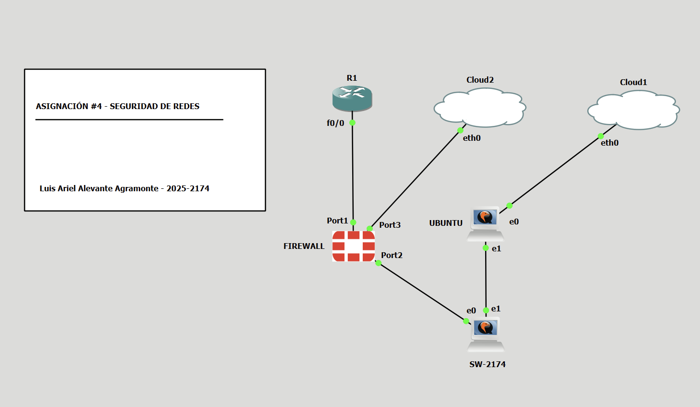

### Diagrama de conexiones y administración

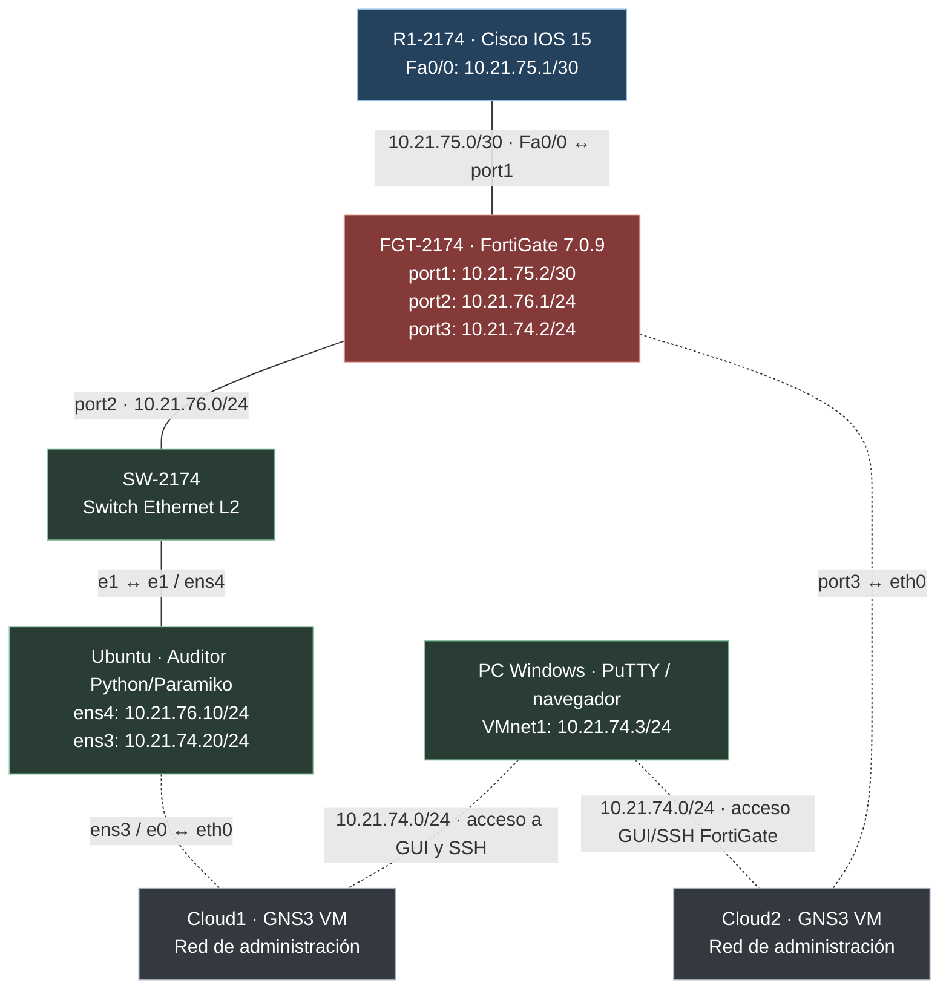

**Lectura del diagrama:** líneas continuas = enlaces de la LAN y del router; líneas punteadas = conexión administrativa mediante Clouds de GNS3 VM. Ubuntu audita al router atravesando FortiGate, y Windows accede a Ubuntu y al firewall por la red de administración. **No se utiliza RADIUS ni Windows Server en esta práctica.**

[Ver diagrama lógico complementario](diagramas/topologia-logica.png)

El enlace R1–FGT usa `10.21.75.0/30`; la LAN protegida usa `10.21.76.0/24`; la administración desde Windows usa `10.21.74.0/24`. Los dos nodos Cloud se ejecutan en GNS3 VM. Para el inventario detallado, ver [direccionamiento final](configuraciones/direccionamiento-final.md).

| Dispositivo | Sistema | Dirección | Papel |
|---|---|---|---|
| R1-2174 | Cisco IOS 15.2(4)S6 | `10.21.75.1` | Router auditado |
| FGT-2174 | FortiOS 7.0.9 | `10.21.75.2`, `10.21.76.1`, `10.21.74.2` | Filtrado de tráfico y administración |
| Ubuntu | Linux | `10.21.76.10`, `10.21.74.20` | Auditor automatizado |
| SW-2174 | Ethernet Switch GNS3 | — | Conmutación L2 |

## 3. Herramientas y procedimientos

- **GNS3 y GNS3 VM:** laboratorio virtual de router, firewall, switch y Ubuntu.
- **Python 3 + Paramiko:** acceso SSH, lectura de configuración, evaluación y aplicación condicional de controles.
- **Cisco IOS 15 y FortiOS 7.0.9:** dispositivos evaluados.
- **PuTTY:** conexión de Windows a Ubuntu y ejecución de herramientas.

Cada programa tiene un menú: **1) auditoría sin modificar, 2) aplicar correcciones y auditar, 3) consultar último informe y 0) salir**. Se solicita contraseña de forma interactiva; no está incrustada en los scripts. La aplicación exige escribir `APLICAR`.

### Ejecución (en Ubuntu configurado para este laboratorio)

```bash
python3 -m pip --version  # opcional: comprobar Python/pip
python3 -c "import paramiko; print(paramiko.__version__)"
python3 scripts/cis_hardening.py
python3 scripts/fortigate_hardening.py
```

**Atención:** los scripts usan por defecto la ruta `~/CIS-2174/informes/` para generar archivos. Las IP y usuarios están definidos en la cabecera de cada script. Solo ejecutar en equipos del laboratorio bajo administración propia. Los algoritmos SSH heredados del Cisco y la confianza automática en claves de host se toleraron exclusivamente en este entorno aislado; no replicar en producción.

## 4. Controles y justificación

### Cisco — 8 comprobaciones

| Control | Razón de seguridad | Aplicación / verificación |
|---|---|---|
| SSH v2 | Evita SSH heredado | `ip ssh version 2` |
| VTY solo SSH | Bloquea acceso Telnet a VTY | `transport input ssh`, `login local` |
| Timeout de consola | Reduce sesiones abiertas | `line con 0` / `exec-timeout 5 0` |
| Timeout AUX | Reduce sesiones abandonadas | `line aux 0` / `exec-timeout 5 0` |
| Banner MOTD | Advierte del acceso restringido | `banner motd` |
| Logging buffered | Conserva eventos locales | `logging buffered 16384 informational` |
| TCP keepalives (entrada) | Detecta sesiones TCP caídas | `service tcp-keepalives-in` |
| TCP keepalives (salida) | Detecta sesiones TCP caídas | `service tcp-keepalives-out` |

### FortiGate — 8 comprobaciones

| Control | Razón de seguridad | Parámetro evaluado |
|---|---|---|
| SSH v1 deshabilitado | Evita protocolo obsoleto | `admin-ssh-v1 disable` |
| Timeout administrativo | Cierra sesiones inactivas | `admintimeout 5` |
| Bloqueo de intentos | Reduce intentos repetidos | `admin-lockout-threshold 3` |
| HTTPS administrativo sin HTTP | Cifra la administración web | `allowaccess` en port3 |
| TLS mínimo para GUI | Rechaza TLS 1.0/1.1 | `admin-https-ssl-versions tlsv1-2` |
| Telnet deshabilitado | Evita gestión insegura | `admin-telnet disable` |
| Auditoría CLI | Registra acciones administrativas | `cli-audit-log enable` |
| Marca de tiempo de acceso | Mejora trazabilidad | `login-timestamp enable` |

**Nota sobre el último control:** el esquema inicial incluía `ssl-min-proto-version TLSv1-2` (TLS saliente), pero esta VM rechazó el valor. Se sustituyó por el control adicional de marca de tiempo; no se presenta como la misma comprobación ni se afirma haber corregido TLS saliente.

## 5. Resultados de auditoría

| Dispositivo y momento | Controles que cumplen | Resultado | Fuente |
|---|---:|---:|---|
| Cisco, previo al hardening | 2/8 | **25 %** | [Informe previo](informes/cisco_01_previo_25pct.txt) |
| Cisco, posterior al hardening | 8/8 | **100 %** | [Informe posterior](informes/cisco_02_posterior_100pct.txt) |
| FortiGate, inicial (primer conjunto de controles) | 5/8 | **62,5 %** | [Evidencia visual](evidencias/05-fortigate-auditoria-inicial.png) |
| FortiGate, intermedio (conjunto actualizado) | 7/8 | **87,5 %** | [Informe intermedio](informes/fortigate_02_intermedio_87_5pct.txt) |
| FortiGate, posterior (conjunto actualizado) | 8/8 | **100 %** | [Informe posterior](informes/fortigate_03_posterior_100pct.txt) |

Los dos porcentajes FortiGate de **62,5 %** y **100 %** son históricos y no proceden de un conjunto completamente idéntico de controles, debido al reemplazo documentado. Los porcentajes reportan **solo ocho controles seleccionados**, no cumplimiento total de CIS.

### Cisco: antes, aplicación y después

| Antes | Aplicación | Después |
|---|---|---|
| 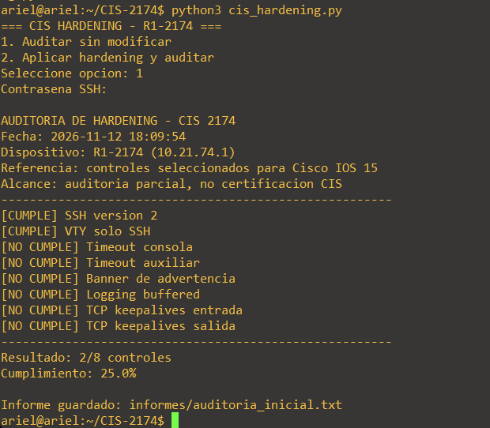 | 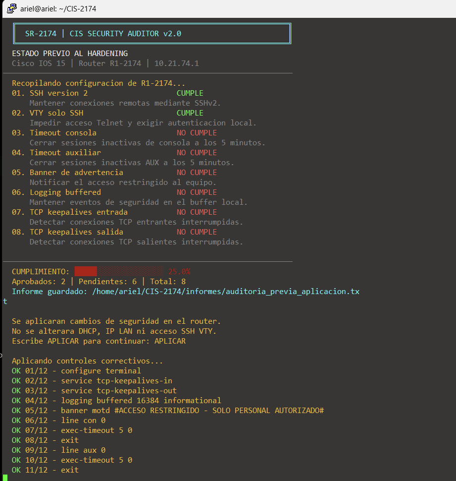 | 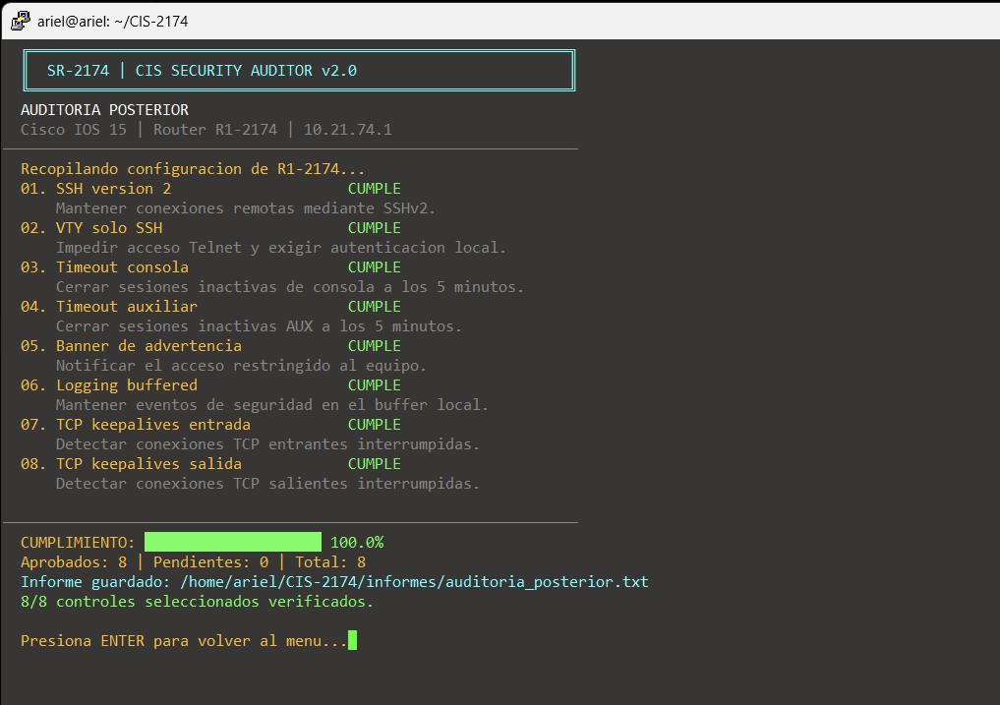 |

### FortiGate: antes y después

| Inicial | Posterior |
|---|---|
| 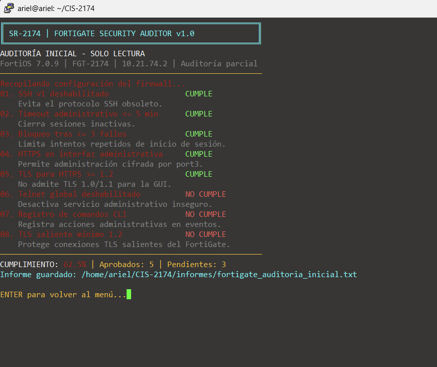 | 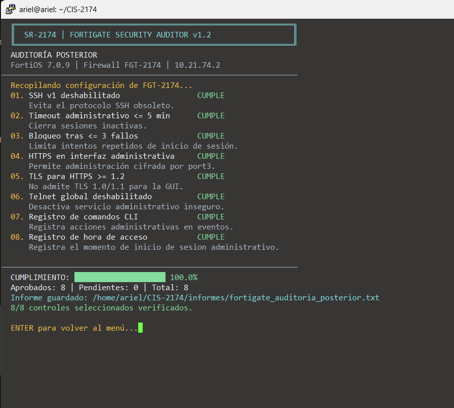 |

## 6. Verificaciones y evidencia funcional

**Cisco:** después del hardening, Ubuntu recuperó la conexión SSH con R1 y mostró el banner administrativo. La auditoría automatizada confirmó los controles y `show logging` comprobó el buffer de registro.

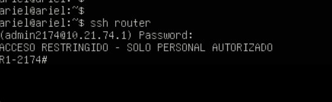

**FortiGate:** las consultas CLI confirmaron `admin-telnet disable`, `cli-audit-log enable` y `login-timestamp enable`, y SSH siguió funcionando.

| Parámetros CLI | Prueba SSH |
|---|---|
| 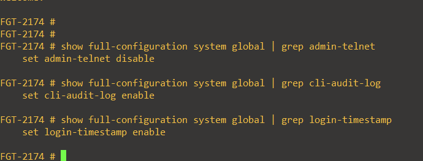 | 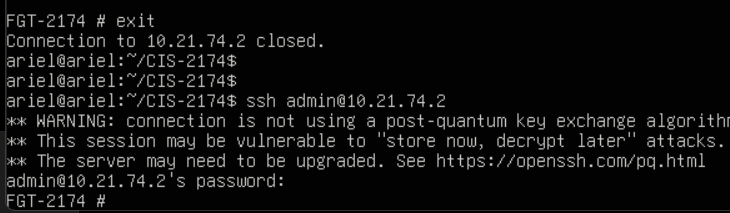 |

La política `UBUNTU_TO_R1_SSH` permite **SSH e ICMP** desde `port2` hacia `port1`, con NAT desactivado. La interfaz muestra tráfico contabilizado y la regla implícita de denegación.

| Interfaces | Política firewall | Ajustes administrativos |
|---|---|---|
| 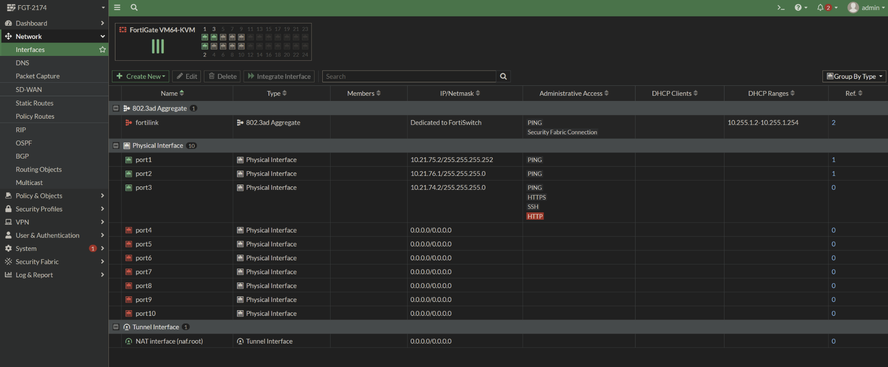 | 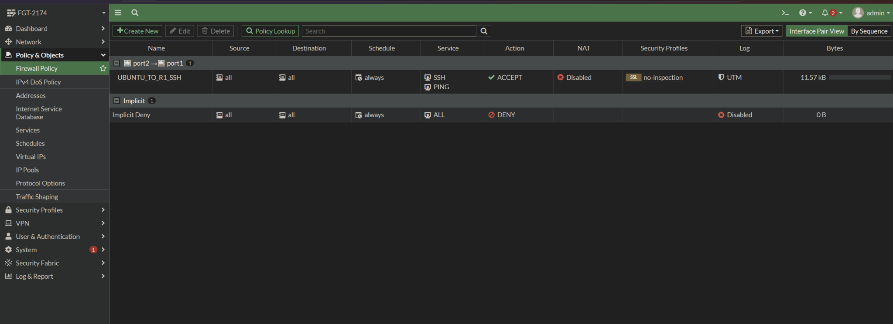 | 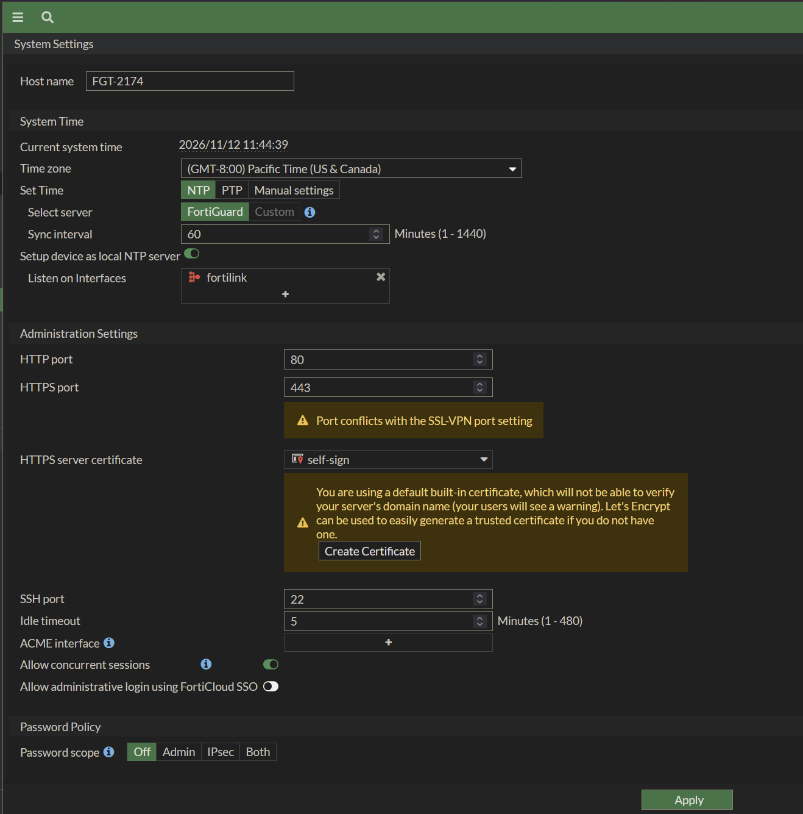 |

## 7. Limitaciones, riesgos y mejoras recomendadas

1. **HTTP en port3:** se activó *después* de la última auditoría para acceder a la GUI mediante `http://10.21.74.2`. La evidencia final muestra HTTP habilitado; **si se ejecuta ahora el auditor FortiGate, su comprobación «HTTPS sin HTTP» puede dar NO CUMPLE**. Para preservar el hardening se debe retirar HTTP y utilizar solo HTTPS. El 100 % reportado corresponde al momento anterior a esta excepción.
2. **Contraseñas del laboratorio:** se utilizaron credenciales débiles en el router para simplificar las pruebas. Se recomienda reemplazarlas por contraseñas robustas y, en producción, por métodos de gestión segura. Las credenciales y hashes no se publican aquí.
3. **Cisco IOS heredado:** la negociación SSH necesitó algoritmos antiguos. Actualizar imagen/equipo cuando sea posible.
4. **FortiOS y licencias:** FortiOS 7.0.9 es antiguo; el entorno presenta capacidades de evaluación. Verificar soporte y actualizar a una versión compatible antes de uso real.
5. **Certificado HTTPS autofirmado y política de contraseñas no activada:** hallazgos adicionales visibles en la GUI, fuera de las ocho comprobaciones.
6. **Regla demasiado amplia:** la política de laboratorio usa `all` en origen y destino. Limitarla a `10.21.76.10` y `10.21.75.1` cuando se consolide el diseño.
7. **Exportaciones históricas:** la configuración Cisco sanitizada se obtuvo antes de cambiar IP y desactivar DHCP; la documentación del direccionamiento final refleja la topología posterior. El archivo no debe usarse como backup restaurable del estado actual.
8. **Evaluación CIS parcial:** no se desarrolló una herramienta certificada que analice el benchmark completo ni se asignaron identificadores oficiales a cada control. Se documentan los criterios y la justificación técnica para revisión académica.

## 8. Estructura del repositorio

```text
SR-PRACTICA-CIS-HARDENING-2174/
├── README.md
├── scripts/                    # auditor Cisco y auditor FortiGate
├── informes/                   # resultados previos/posteriores y notas
├── configuraciones/            # resúmenes sanitizados y direccionamiento
├── diagramas/                  # diagrama lógico en PNG/SVG/DOT
└── evidencias/                 # capturas reales seleccionadas
```

**Privacidad:** los `running-config` originales con hashes, contraseñas, claves privadas, archivos temporales o copias completas sensibles no se incluyen.

## 9. Referencias técnicas

- [CIS Benchmarks](https://www.cisecurity.org/cis-benchmarks) — marco de referencia, sin alegar evaluación oficial integral.
- [Fortinet FortiOS 7.0 Administration Guide](https://docs.fortinet.com/document/fortigate/7.0.9/administration-guide) — documentación del producto.
- [Cisco IOS Security Configuration Guide](https://www.cisco.com/c/en/us/support/ios-nx-os-software/ios-software-releases-15-2-s/products-installation-and-configuration-guides-list.html) — documentación de familia IOS (verificar soporte exacto en cada imagen).

---

**Entrega académica — SR-2174 | Hardening parcial de Router y Firewall en GNS3.**
